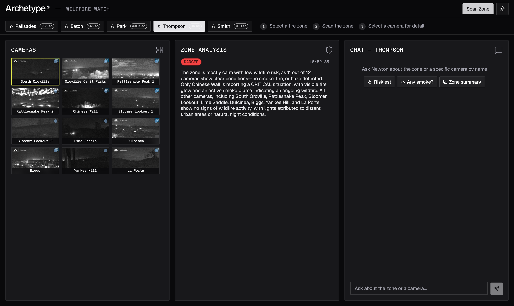

# Newton Wildfire Watch (Inference API)

Real-time wildfire detection dashboard powered by [Newton](https://www.archetypeai.io/) and the [ALERTCalifornia](https://alertcalifornia.org/) camera network.

Monitors 1,200+ wildfire cameras across California, focused on 5 major fire zones from recent devastating wildfires. Newton analyzes live camera frames for smoke, fire, haze, and visibility changes.

This is the Inference API version of [archetypeai-wildfire-demo](https://github.com/archetypeai/archetypeai-wildfire-demo), which uses the Direct Query API. [MIGRATION.md](MIGRATION.md) explains what changed and compares the two.



## Fire Zones

| Zone      | Fire           | Year     | Acres   | County         |
| --------- | -------------- | -------- | ------- | -------------- |
| Palisades | Palisades Fire | Jan 2025 | 23,448  | Los Angeles    |
| Eaton     | Eaton Fire     | Jan 2025 | 14,021  | Los Angeles    |
| Park      | Park Fire      | Jul 2024 | 429,603 | Butte / Tehama |
| Thompson  | Thompson Fire  | Jul 2024 | 3,000+  | Butte          |
| Smith     | Smith Fire     | Feb 2025 | 700+    | San Diego      |

## Features

- **Multi-camera grid** — browse up to 12 cameras per fire zone with auto-refreshing thumbnails (15s) and a live per-camera risk dot
- **Continuous zone scan** — one toggle scans every camera in the zone on a loop (~30s cycle), keeping the risk dots fresh; a countdown shows when the next scan runs
- **Per-camera detail** — click any camera to open a modal with its live frame and Newton's detailed analysis
- **Risk classification** — Clear / Watch / Danger labels based on Newton's assessment
- **Zone analysis history** — a running log of zone-level overviews over time
- **Zone chat** — ask Newton about the whole zone or a specific camera, grounded in the latest scan
- **Zone switching** — switch between 5 fire zones to monitor different regions

## Stack

- **SvelteKit** with Svelte 5 runes
- **Archetype AI Design System** — semantic tokens, component primitives, composite patterns
- **Geist and Geist Mono** — open-source fonts from `@fontsource-variable`
- **Newton Inference API** — Newton C 2.6 (`newton-c-2.6`) through the stateless Chat Completions endpoint (`POST /api/inference/chat/completions`); no session
- **ALERTCalifornia** — public camera data (JPEG snapshots, no auth required)
- **Tailwind v4** — styling with semantic design tokens

## Setup

Requires Node.js 20 or later:

```bash
git clone https://github.com/archetypeai/archetypeai-wildfire-demo-inference-api.git
cd archetypeai-wildfire-demo-inference-api
npm install
cp .env.example .env      # then add your API key
```

`.env` holds your Archetype AI API key and the production endpoint:

```
ATAI_API_KEY=your_api_key_here
ATAI_API_ENDPOINT=https://platform.u1.archetypeai.app
```

The `.env` file wins over any `ATAI_*` variables exported in your shell (see `vite.config.js`).

## Development

```bash
npm run dev
```

Open `http://localhost:5173`, select a fire zone, then click **Scan Zone**.

## How It Works

All Newton calls are stateless `POST /api/inference/chat/completions` requests to `newton-c-2.6`: a system message, then a user message of image parts (camera frames as `data:image/jpeg;base64,…` URLs) and the question. There is no session lifecycle.

1. Select a fire zone — up to 12 nearby cameras load from the ALERTCalifornia API
2. **Scan Zone** starts a continuous loop. Each pass sends the zone's frames in small **multi-image batches**, run one after another: up to 4 frames per request, fewer when four would pass the endpoint's ~2 MiB request limit. Each batch returns a per-camera risk status
3. A final **text-only** request synthesizes a single zone overview from the per-camera findings. Statuses drive the grid risk dots; the overview is appended to the Zone Analysis history
4. Click any camera to open a modal with its full frame and a fresh **detailed** analysis (a single-image request)
5. The chat answers questions about the zone or a specific camera by name, grounded in the latest scan findings (text-only request)

## Latency

Measured on production on 2026-11-14, model already warm:

| Call                                                   | Time   |
| ------------------------------------------------------ | ------ |
| Zone scan (12 cameras: 3 image batches + the overview) | ~16 s  |
| One camera's detailed analysis                         | ~4–9 s |
| Chat answer                                            | ~1–3 s |

## Known Limitations

- **Downscaled frames.** The Inference API gives the model a reduced copy of each 1920×1080 frame (the model describes it as low-resolution and squashed), so it sees less detail than the Direct Query version did. The risk prompt therefore tells the model which look-alikes (fog, low cloud, night lights) aren't smoke or fire; see [MIGRATION.md](MIGRATION.md#results). It still flags some night scenes, such as a lit wall or skyglow, as watch or danger.
- **Request size.** Chat Completions refuses requests over about 2 MiB, so night frames, which are larger, sometimes go in batches of two or three.

## Licence

The code is licensed under the [Apache License 2.0](LICENSE). Camera images are fetched live from [ALERTCalifornia](https://alertcalifornia.org/) and are not part of this repository.
